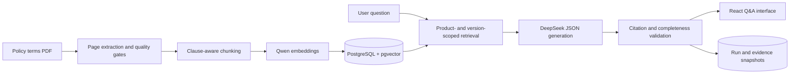

# Insurance AI Agent

A local RAG application for understanding insurance policy terms. It extracts and chunks PDF documents, builds a traceable vector index, and answers questions through a web interface with expandable source evidence.

The project has completed **Milestone 7** and now provides a full local demo from document ingestion to browser-based Q&A. It is built for learning and engineering validation, is not affiliated with any insurer, and does not make underwriting, claim, eligibility, or payment decisions.

## The problem this project addresses

Reliable insurance Q&A requires more than generating a plausible response. Every conclusion should be traceable to the correct product, policy version, clause, and physical PDF page. This project treats that evidence chain as a core system constraint:

- Answers use only imported insurance documents and include expandable source excerpts.
- Product and policy version are explicit retrieval boundaries, preventing content from different contracts from being mixed.
- Every citation must come from the evidence retrieved for that run; the model cannot invent a source.
- If evidence supports only part of a question, the system abstains from answering the entire question.
- Each run persists its retrieval results, actual context, model output, and source snapshots for later review.

## What you can try today

The local web application lets you:

1. Select an indexed insurance product and policy version.
2. Ask a self-contained question about its terms.
3. Read either a grounded answer or an explicit abstention.
4. Expand citations to inspect the document name, version, physical page, excerpt, and full source chunk.
5. Retrieve the persisted run snapshot by `run_id` for backend review.

Page messages live only in browser memory and disappear on refresh, while backend run records remain available. Every question is processed independently; conversation history is not used to infer missing context.

## End-to-end pipeline



## Engineering highlights

| Area | Current implementation |
| --- | --- |
| PDF correctness | Preserves physical and blank pages, rejects empty text and `U+FFFD`, and never asks an LLM to repair policy wording |
| Deterministic chunking | Keeps every chunk on one physical page, recognizes common clause identifiers, carries metadata across pages, and splits long text with stable rules |
| Retrieval isolation | Requires a product, requires explicit selection when multiple versions exist, and rejects incompatible embedding profiles |
| Verifiable generation | The model returns structured JSON; Go validates evidence IDs and verbatim source substrings before rendering citations |
| Conservative abstention | Similarity is not treated as confidence; incomplete evidence causes whole-question abstention |
| Reproducibility | Retrieval, actual context, final model content, and source snapshots are persisted independently of live chunk rows |
| Concurrency and recovery | Model requests stay outside database transactions; indexing commits in recoverable batches; replacement and indexing share document locks |
| Frontend safety | Answers and evidence render as text, only HTTP/HTTPS sources become links, and canceled requests cannot apply late responses |

## Technology stack

| Layer | Technology |
| --- | --- |
| Backend and CLI | Go 1.27.3, Gin, CloudWeGo Eino |
| PDF extraction | Python 3, pdfplumber 0.11.9 |
| Storage and retrieval | PostgreSQL 17, pgvector 0.8.7, HNSW and exact cosine search |
| Embeddings | `Qwen/Qwen3-Embedding-0.6B`, 1,024 dimensions, OpenAI-compatible endpoint |
| Generation | DeepSeek Flash, thinking disabled, JSON Object output |
| Web | React, TypeScript, Vite, plain CSS |
| Verification | Go test, Vitest, React Testing Library, Playwright |

Go owns application rules, quality gates, persistence, and citation validation. Python is limited to PDF text extraction through `pdfplumber`. The browser calls only the same-origin Go API and never connects directly to the database or model providers.

## Milestones

| Milestone | Deliverable | Status |
| --- | --- | --- |
| M1 | PDF ingestion, page extraction, SHA-256, and quality gates | Complete |
| M2 | Deterministic, clause-aware chunking | Complete |
| M3 | PostgreSQL catalog, migrations, idempotent storage, and replacement | Complete |
| M4 | Qwen embeddings, pgvector, and recoverable indexing | Complete |
| M5 | Product/version-scoped vector retrieval and an exact-search baseline | Complete |
| M6 | Evidence-grounded answers, abstention, citation validation, and run snapshots | Complete |
| M7 | Local React Q&A interface with same-origin Go static hosting | Complete |
| M8 | System evaluation, failure analysis, and reproducible delivery | Planned |

The repository advances in small, reviewable milestones. Each stage keeps an independent command, test suite, and learning note so the complete path from a policy PDF to a verifiable answer remains easy to study.

## Repository map

```text
cmd/                 CLI and API entry points
internal/            Parsing, chunking, catalog, indexing, retrieval, RAG, and adapters
db/migrations/       Append-only PostgreSQL migrations
web/                 React and TypeScript Q&A interface
docs/learning/       Milestone designs, experiments, and acceptance records
testdata/            Synthetic samples, offline regression PDFs, and Q&A cases
scripts/             Manual live-integration utilities
```

## Getting started

Environment setup, database startup, PDF ingestion, chunking, storage, embedding, retrieval, API, web, and test commands are documented in the:

**[Local setup and development guide](docs/getting-started.md)** *(Chinese)*

For a guided code tour, start with M7 to see how the web interface composes the existing services, then follow the earlier milestones as needed:

- [M7: Local Q&A interface](docs/learning/m7-local-chat.md) *(Chinese)*
- [M6: Evidence-grounded insurance Q&A](docs/learning/m6-evidence-grounded-answers.md) *(Chinese)*
- [M5: Product-scoped vector retrieval](docs/learning/m5-vector-retrieval.md) *(Chinese)*
- [M4: Embeddings and pgvector indexing](docs/learning/m4-embedding-indexing.md) *(Chinese)*
- [M3: PostgreSQL persistence](docs/learning/m3-postgresql-persistence.md) *(Chinese)*
- [M2: Clause-aware chunking](docs/learning/m2-clause-chunking.md) *(Chinese)*
- [M1: PDF ingestion and extraction](docs/learning/m1-pdf-ingest.md) *(Chinese)*

## Current scope

This is a local, single-user learning project. It does not currently include authentication, a document-management UI, OCR, conversational memory, streaming answers, hybrid search, reranking, or production-system integrations. Complex tables, rotated text, and PDFs with unreliable content order still require manual page-level review. Passing automated checks does not constitute legal or insurance-content certification.

Use only public, lawfully obtained, or explicitly authorized insurance documents. Do not import real customer policies, identity data, or health data without authorization.
