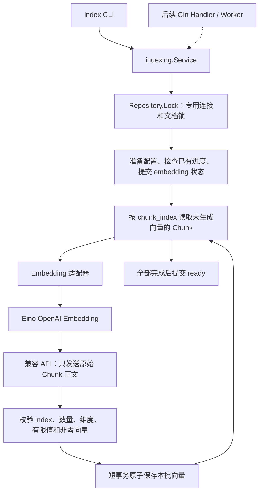

# M4：Embedding 与 pgvector 索引

M4 的输入是 M3 数据库中的文档 UUID，输出是同一批 Chunk 的向量、模型记录和完成状态。Embeddings 是模型返回的数值表示，不能替代条款原文，也不意味着条款已被人工核验。M5 才用问题向量查找相关条款。

## 环境和固定版本

- Go 1.27.3；在项目根目录运行 `go version` 应显示这个版本。旧 Go 安装可通过自动工具链下载使用它；离线环境需预先安装。
- Eino `v0.9.22`、OpenAI Embedding 适配器 `v0.0.0-20261019121619-eee37f63ff95`、Sonic `v1.15.4`。完整依赖和校验值见 `go.mod/go.sum`。
- 继续使用 Docker Compose 中的 PostgreSQL 17 与 pgvector 0.8.7，显式执行 `migrate --action up`。
- 默认模型为本地 `Qwen/Qwen3-Embedding-0.6B`，固定输出 1024 维。默认连接本机 vLLM；远程兼容服务的密钥只通过运行环境传入。

Go 升级不要求改变 M1/M2 JSON 格式。Python 仍只负责 PDF 提取。Eino 的模型调用被隔离在适配器里，索引服务不依赖 Eino 或 Gin 类型。

## 数据流和阅读顺序



推荐阅读顺序：

1. `internal/indexing/indexing.go`：先看 `Embedder`、`Repository`、`Session`，再看 `Service.Index`。
2. `internal/embedding/eino.go`：看 Eino 配置、响应顺序修正和重试分类。
3. `internal/postgres/indexing.go`、`00002` 与 `00003`：看锁的生命周期、短事务和向量维度升级。
4. `cmd/index/main.go`：看参数、环境变量、信号取消和依赖组装。
5. 阅读对应测试，理解失败时数据库应保留什么。

CLI 只把参数转成 `indexing.Request`。后续 Gin Handler 可以调用同一 `Service.Index(context.Context, Request)`；不能把 `gin.Context` 传入仓库，也无需在服务端执行 CLI。长耗时索引的后台任务调度留待后续阶段，M4 的 `Session` 生命周期由每次应用服务调用管理。

## 从 Chunk 到索引

先按 README 完成 `ingest → chunk → store`，记录 `store` 输出的 UUID。另行安装 vLLM 并启动本地 OpenAI 兼容服务：

```bash
vllm serve Qwen/Qwen3-Embedding-0.6B \
  --runner pooling \
  --host 127.0.0.1 \
  --port 8001
```

项目默认使用以下配置：

```bash
export EMBEDDING_BASE_URL='http://127.0.0.1:8001/v1'
export EMBEDDING_MODEL='Qwen/Qwen3-Embedding-0.6B'
go run ./cmd/index --document-id '<UUID>' --batch-size 16
```

CLI 不自动读取 `.env`。`BASE_URL` 是基础路径而非完整 `/embeddings` 接口。回环地址可以省略 `EMBEDDING_API_KEY`；远程地址必须配置。兼容服务必须接受 `dimensions: 1024`，返回带 `index` 的浮点向量数组。不支持这些字段的服务会明确失败，不会静默接受不同维度或猜测响应对应关系。

Eino 当前适配器按响应数组顺序输出向量，而 API 响应项还包含 `index`。本项目通过自定义 HTTP transport 校验完整的 index 排列并重排响应，再交给 Eino 解码；重复、缺失或越界 index 都失败。适配器和应用服务均检查向量，防止 NaN、无穷、float32 溢出和零向量进入余弦索引。

模型配置标识是规范化地址、模型名与维度的 SHA-256，不包含密钥。更换密钥不需要重建；换地址或模型需要 `--reindex`。这里记录的是请求配置，不保证第三方服务背后的模型权重永远不变，应优先选择能固定模型版本的服务。

HNSW 索引使用 `vector_cosine_ops`。向量和模型写入 Chunk 原行，原文与元数据继续保留；索引建成后还需要 M5 的 Query Embedding、过滤和 Top K 流程才能用于检索。

## 失败续跑、重建和并发

| 情况 | 行为 |
| --- | --- |
| 首次索引 | `chunked → embedding → ready` |
| 第三批失败，前两批已保存 | 状态变为 `failed`，保留前两批；重跑只补齐缺失向量 |
| 进程被终止 | 数据库连接释放锁；可能保留 `embedding` 状态，重跑继续 |
| 所有批次保存后、ready 前中断 | 重跑不再调用模型，检查完整性后标记 `ready` |
| 已经完整且配置一致 | 返回 `skipped`，复用全部向量 |
| 配置与已有记录不同 | 拒绝，要求显式 `--reindex` |
| 显式重建 | 原子清空全部旧向量和完成标记，然后从头处理 |
| 同一文档并发索引 | 后来的调用返回“处理中” |
| 索引期间替换 Chunk | `store --replace` 返回“处理中” |
| 替换 Chunk 成功 | 删除旧 Chunk 与向量，清空模型配置，回到 `chunked` |

一次模型请求最多等待 60 秒，临时网络故障及 408、429、5xx 最多重试三次。自动重试是当前运行里的补救；失败续跑是退出后重新运行命令的恢复。认证、参数和响应校验错误不会自动重试。

每个批次保存为独立事务，事务中任何一行失败，整个批次回滚。模型 API 请求不占用事务。索引期间持有的是专用连接的文档级 advisory lock；替换使用同一 key 的事务级锁。所有索引 SQL 都走持锁连接，连接失效后不会透明切换到其他连接继续写入。

释放锁失败时丢弃物理连接，避免把仍持有锁的连接放回池。若错误处理时数据库也不可用，不能保证已写入 `failed`；命令会报告“无法保存失败状态”，稍后重跑即可按缺失向量恢复。`last_error` 只保存安全的阶段类别，详细的安全错误说明在命令输出中；不记录 API 原始错误正文、密钥或条款请求体。

## 查询与小实验

查看每份文档完成数量：

```sql
SELECT d.id, d.processing_status, d.embedding_model, d.embedding_dimensions,
       d.total_chunks, count(c.embedding) AS embedded_chunks,
       d.failed_stage, d.last_error, d.indexed_at
FROM documents d
LEFT JOIN document_chunks c ON c.document_id = d.id
GROUP BY d.id;

SELECT chunk_index, page_number, embedding_model,
       vector_dims(embedding) AS dimensions, embedded_at
FROM document_chunks
WHERE document_id = '<UUID>'
ORDER BY chunk_index;
```

选一份含多个 Chunk 的自建文档，先以 `--batch-size 1` 索引，随后用相同命令重跑，观察第二次 `skipped`、处理数 0 和复用数。再以 `--reindex --batch-size 4` 重建，观察完成时间与请求数量的变化；本地模型没有按 Token 计费，但会再次占用计算资源。

如需不启动模型就观察故障恢复，运行模拟 HTTP 测试与数据库集成测试：前者模拟限流、超时和乱序，后者在第二批失败后验证第一批保留、重跑只补缺失向量。测试数据库必须独立且名称包含 `test`，会清空数据和回退迁移。

## 验收与限制

- 在 Go 1.27.3 下执行 `go test ./...`、`go test -race ./...`、`go vet ./...` 并构建五个 CLI。
- 设置 `TEST_DATABASE_URL` 后验证 M3 升级保留原文、1536→1024 迁移、M4 回退保留 M3 表、完整迁移重放、批次回滚、并发锁和连接丢失。
- M1/M2 的两份真实 PDF 回归继续运行；不要替换原夹具。
- 本地模拟 HTTP 测试验证的是协议与工程行为，真实模型可用性和向量语义质量仍需独立验证。未配置真实密钥时，真实联调应标记为未验证。
- 批大小按 Chunk 数量控制，没有 Token 估算或自动拆分。单个 Chunk 超出模型限制时应回到切分阶段处理，不能截断或修补保险原文。
- 每份文档只有一套向量；重建会立即使旧向量失效，失败时不会自动恢复旧模型索引。
- 每个正在索引的文档占用一个连接，连接池上限仍为 10；后续 Worker 需要控制并发数。数据库应直接连接或使用 session pooling，不能通过 transaction pooling 持有 session advisory lock。

复盘问题：为什么 API 请求不放进事务？为什么不能只根据 `processing_status` 判断续跑进度？为什么同维度模型也不能直接混用旧向量？为什么替换和索引必须共享同一把锁？

## 本次验证记录（2026-10-26）

- Go 1.27.3 下全量 `go test ./...`、`go test -race ./...`、`go vet ./...` 通过，五个 CLI 构建成功。
- Docker 中的独立 `insurance_agent_m4_test` 数据库参与普通测试和竞态测试；覆盖真实迁移、HNSW、事务及锁，不是跳过数据库测试的结果。
- 两份真实 PDF 的解析和切分回归均包含在全量测试中。
- 自建三页 PDF 完整运行 `ingest → chunk → store → index`，本地模拟服务在第二批返回 401：首次保存 1 个 Chunk 后失败，重跑处理剩余 2 个并复用 1 个，再次运行跳过全部 3 个，显式重建重新处理全部 3 个。整个演示共发出 5 次模拟请求。
- 演示记录位于忽略目录 `var/m4-smoke/result.json`；生成的页面和 Chunk JSON 也保存在 `var/m4-smoke/`，不进入 Git。
- **Qwen 本地模型联调未验证**：本次自动化测试只使用本地模拟 HTTP 服务，没有下载模型权重或验证向量语义质量。
